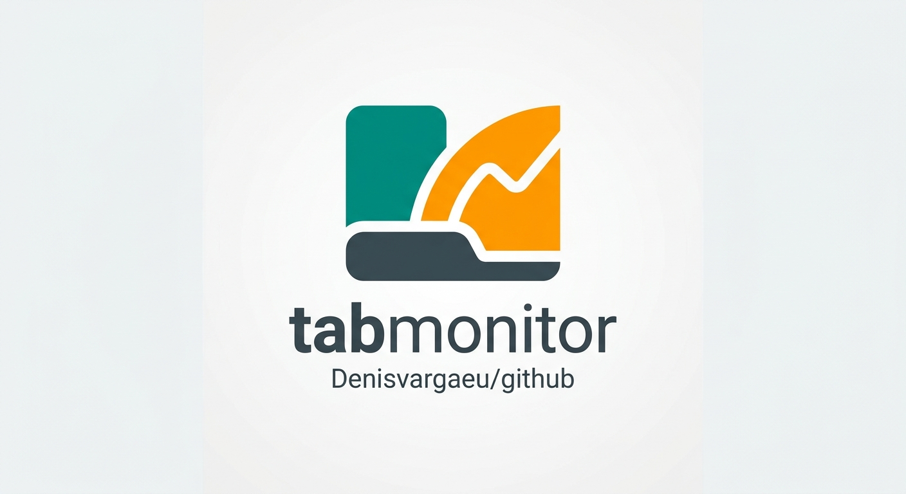
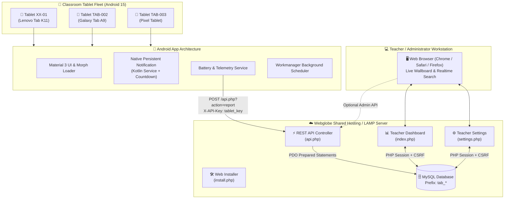
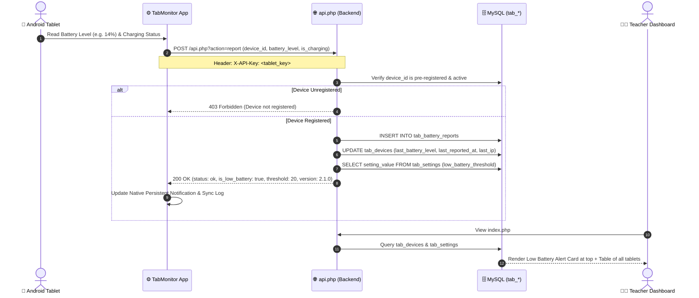
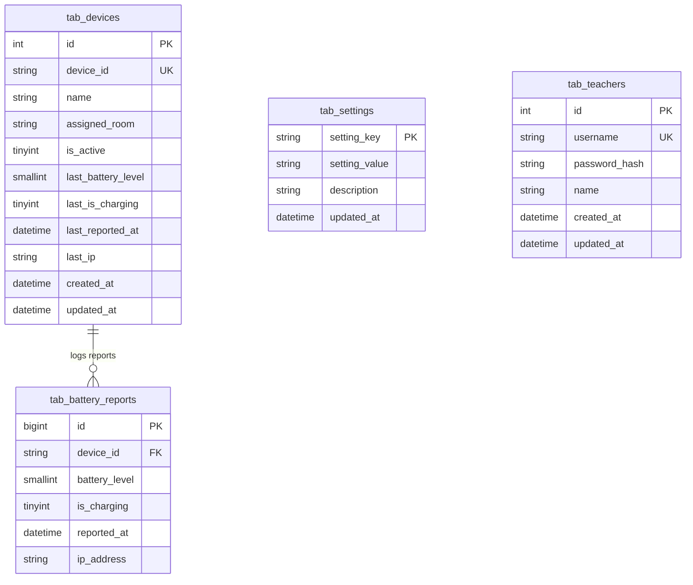

<div align="center">



<p align="center">
  
</p>

# 🔋 TabMonitor `v2.1.0`
### Enterprise Classroom Tablet Fleet & Battery Telemetry Ecosystem

[](https://www.php.net/)
[](https://flutter.dev/)
[-3DDC84?style=for-the-badge&logo=android&logoColor=white)](https://developer.android.com/)
[](https://www.mysql.com/)
[](https://www.webglobe.sk/)
[](https://m3.material.io/)
[](LICENSE)

<br/>

**TabMonitor** is an end-to-end telemetry and fleet battery monitoring solution engineered for schools, universities, and educational tablet pools. It connects native **Android 15 (Material 3)** student tablets directly to a lightweight, zero-dependency **PHP 8.x + MySQL Web Admin & REST API** built specifically for **Webglobe shared hosting** and modern LAMP/cPanel environments.

[Features](#-key-features--highlights) • [Architecture](#-system-architecture) • [Web Admin](#-teacher-web-dashboard-phase-2) • [Android App](#-android-15-client-app-phase-3) • [Installation](#-installation--deployment) • [API Docs](#-rest-api-v210-specification) • [Security](#-security-architecture)

</div>

---

## 📋 Table of Contents

- [✨ Key Features & Highlights](#-key-features--highlights)
- [🏗️ System Architecture](#-system-architecture)
- [📁 Repository Structure](#-repository-structure)
- [💻 Teacher Web Dashboard (Phase 2)](#-teacher-web-dashboard-phase-2)
- [📱 Android 15 Client App (Phase 3)](#-android-15-client-app-phase-3)
- [🚀 Installation & Deployment](#-installation--deployment)
  - [Method A: Web Installer (`install.php`)](#method-a-web-installer-installphp--recommended)
  - [Method B: Manual Setup (`schema.sql` & `config.php`)](#method-b-manual-setup-webglobe--cpanel)
  - [Method C: Local Development Server](#method-c-local-development-server)
- [📲 Building & Installing the Android App](#-building--installing-the-android-app)
- [📡 REST API v2.1.0 Specification](#-rest-api-v210-specification)
  - [1. Test Connection](#1-test-connection-actiontest)
  - [2. Submit Battery Report](#2-submit-battery-report-actionreport)
  - [3. Fetch Tablet Fleet Status](#3-fetch-tablet-fleet-status-actiondevices-teacher-only)
  - [4. Manage Threshold Settings](#4-manage-threshold-settings-actionsettings-teacher-only)
  - [5. Pre-Register or Update Device](#5-pre-register-or-update-device-actionregister-device-teacher-only)
- [🗄️ Database Schema Reference](#-database-schema-reference)
- [🔒 Security Architecture](#-security-architecture)
- [🛠️ Troubleshooting & FAQ](#-troubleshooting--faq)
- [📄 License & Credits](#-license--credits)

---

## ✨ Key Features & Highlights

### 🌐 Backend & Web Admin
- **Webglobe Shared Hosting Optimized**: Zero heavy dependencies, no Node.js, no Docker, and no daemon background daemons required. Operates seamlessly on standard shared hosting.
- **Prefix Isolation (`tab_`)**: 100% of tables and SQL operations are prefixed with `tab_`, allowing TabMonitor to safely coexist with other software on a shared database.
- **Automated Web Installer (`install.php`)**: Interactive setup wizard that validates database credentials, runs database migrations, creates tables, and writes `config.php`.
- **Live Classroom Fleet Wallboard**: Visual cards showing total registered tablets, active online devices, offline devices, and real-time low battery warnings.
- **Dynamic Device Management**: Add, toggle active status, or delete tablet IDs (`TAB-001`, `XX-01`) directly through an interactive modal in the browser.
- **Dynamic Threshold Slider**: Real-time configurable low-battery alert threshold (0–100%) stored in the database and distributed to all connected tablets.
- **Instant Client-Side Search & Filters**: Search across IDs, tablet names, or assigned classrooms with one-click filters for Low Battery, Offline, or Charging.
- **Unified Version Protocol (`v2.1.0`)**: Version badges displayed across all web views, injected into JSON responses, and delivered in `X-TabMonitor-Version` HTTP headers.

### 📱 Android Client App
- **Material 3 Expressive UI**: Built using Flutter 3.24.5 & Dart 3.5.4, adhering strictly to Material 3 design tokens and dynamic color schemes.
- **Canonical 7-Shape Morphing Loader**: Custom mathematical bezier-path animation (`M3ShapeMorphLoader`) cycling through the 7 canonical M3 shapes: *Circle → Four-Point Star → Rounded Rectangle → Oval → Pill → Cut-Corner Squircle → Clover*.
- **4-Step Interactive Setup Wizard**:
  1. *Connection Setup*: Live server URL & API key ping verification.
  2. *Permissions Checklist*: Interactive checklist with deep links directly into Android system settings (Battery Optimization bypass, Notifications, Network).
  3. *Device ID Assignment*: Hardware ID assignment with pre-registration check.
  4. *Configuration Review*: Final verification and instant sync.
- **Device-Agnostic Dynamic Hardware Telemetry**: Automatically queries real device manufacturer, model, and battery stats via `device_info_plus` and `battery_plus` (works identically on Lenovo Tab K11, Samsung Galaxy Tab, Google Pixel Tablet, Xiaomi Pad, or phones).
- **Native Android 15 Persistent Notification**: Background notification managed via Kotlin (`TabMonitorNotificationManager.kt`) showing battery percentage, charging state, and a live countdown to the next upload.
- **Resilient Periodic Sync**: Scheduled background reporting with `Workmanager`, exponential retry backoff, and local sync history logging.
- **Diagnostics Clipboard Export**: Single-click diagnostic bundle export containing hardware specs, Android OS version, client version `2.1.0+2`, and server API version.

---

## 🏗️ System Architecture



### Telemetry & Reporting Flow



---

## 📁 Repository Structure

```
tabmonitor/
├── banner.jpg                 # Official TabMonitor repository banner (1408x768)
├── icon.jpg                   # Official TabMonitor logo icon (1408x768)
├── install.php                # Web Installer: DB setup, tab_* table migrations, config writer
├── api.php                    # REST API Controller: endpoints (test, report, devices, settings)
├── db.php                     # Secure PDO database connector, settings helpers, session auth
├── config.php                 # App configuration: DB credentials, security keys, timezone
├── schema.sql                 # Complete MySQL schema DDL with tab_ prefix isolation
├── index.php                  # Teacher Web Dashboard: live telemetry, fleet table, device modal
├── settings.php               # Teacher Settings: threshold slider (0-100%), password change
├── login.php                  # Secure teacher sign-in with timing-safe hash check & CSRF
├── logout.php                 # Secure session destruction and cookie invalidation
├── style.css                  # Zero-dependency responsive stylesheet with CSS custom properties
├── README.md                  # Flagship documentation and technical reference
└── app/                       # Android 15 Client App (Flutter / Dart / Native Kotlin)
    ├── pubspec.yaml           # Flutter dependencies & app version (2.1.0+2)
    ├── android/               # Native Android project configuration
    │   └── app/src/main/kotlin/com/tabmonitor/app/
    │       ├── MainActivity.kt                  # MethodChannel bridge for native settings & notifications
    │       └── TabMonitorNotificationManager.kt # Android persistent notification & countdown manager
    └── lib/                   # Dart / Flutter application source code
        ├── main.dart                            # Application entry point & route switcher
        ├── models/
        │   ├── api_response.dart                # API response models & version parser
        │   ├── device_config.dart               # Stored device settings & credentials model
        │   └── sync_log_entry.dart              # Telemetry sync history entry model
        ├── screens/
        │   ├── setup_screen.dart                # 4-Step Material 3 interactive setup wizard
        │   ├── dashboard_screen.dart            # Multi-functional tablet telemetry dashboard
        │   └── background_info_sheet.dart       # Educational guide for Android 15 background limits
        ├── services/
        │   ├── api_service.dart                 # HTTP client with version headers & error handling
        │   ├── battery_service.dart             # Dynamic device battery state listener
        │   ├── storage_service.dart             # Secure local storage (FlutterSecureStorage)
        │   ├── system_settings_service.dart     # Native intent caller for system settings
        │   └── background_service.dart          # Workmanager background execution scheduler
        └── widgets/
            ├── m3_shape_morph_loader.dart       # Canonical 7-shape bezier morphing loader
            └── permissions_checklist.dart       # Interactive checklist with direct system links
```

---

## 💻 Teacher Web Dashboard (Phase 2)

The Teacher Web Dashboard provides an instant, responsive birds-eye view of your entire school tablet inventory.

```
+---------------------------------------------------------------------------------------+
| 🔋 TabMonitor v2.1.0               Classroom Fleet               [ ⚙️ Settings ] [ 🚪 Logout ] |
+---------------------------------------------------------------------------------------+
|  [ 📱 Total: 32 ]    [ 🟢 Online: 29 ]    [ 🔴 Offline: 3 ]    [ ⚠️ Low Battery: 4 ]  |
+---------------------------------------------------------------------------------------+
|  ⚠️ LOW BATTERY TABLETS (Below 20% Threshold)                                         |
|  • TAB-004 (Room 102) - 12% 🔴 [====------] - Not Charging - Last seen: 2m ago       |
|  • TAB-012 (Art Lab)  - 15% 🔴 [=====-----] - Not Charging - Last seen: 5m ago       |
+---------------------------------------------------------------------------------------+
|  All Registered Tablets                   [ 🔍 Search ID / Room... ] [ + Add Tablet ] |
|  Filters: [ All ] [ Low Battery ] [ Offline ] [ Charging ]      [x] 30s Auto-Refresh  |
|  -----------------------------------------------------------------------------------  |
|  ID        Name         Room        Battery        Status    Last Contact    Actions  |
|  -----------------------------------------------------------------------------------  |
|  TAB-001   Tablet 01    Room 101    84% 🟢 ⚡ Chg  Online    1m ago          [Edit]   |
|  TAB-002   Tablet 02    Room 101    62% 🟢 Batt    Online    3m ago          [Edit]   |
|  TAB-003   Tablet 03    Room 102    38% 🟡 Batt    Online    4m ago          [Edit]   |
+---------------------------------------------------------------------------------------+
```

### Dashboard Capabilities:
1. **At-a-Glance Metrics**: Instant summary counters for Total Tablets, Active Online, Inactive/Offline, and Low Battery alerts.
2. **Dedicated Low Battery Section**:
   - Tablets below the server-configured threshold are automatically pulled into an alert banner at the top of the screen.
   - Highlights battery percentage, charging state, room name, and relative contact timestamp.
3. **Interactive Device Management Modal**:
   - Add new tablet IDs (e.g. `TAB-006`, `XX-01`, `LAB-01`) directly through the browser without modifying SQL tables.
   - Toggle tablet active/inactive states or delete retired tablets with full referential safety.
4. **Real-Time Client-Side Search & Quick Filters**:
   - Instant filtering as you type by Device ID, Name, or Assigned Room.
   - Filter pills to view only Low Battery devices, Offline devices, or Charging devices.
5. **Configurable Alert Threshold (`settings.php`)**:
   - Interactive slider and numeric input from **0% to 100%**.
   - Immediate database persistence; new threshold is distributed to tablets upon their next sync.
6. **Classroom Wallboard Mode**:
   - Built-in 30-second auto-refresh toggle for unattended classroom monitors and wall-mounted dashboards.
7. **⚡ Fleet Force Reload & Live Telemetry Acquisition**:
   - Prominent `⚡ Vynútiť načítanie zo zariadení` toolbar button broadcasts an urgent telemetry sync signal across all tablets.
   - Connected tablets instantly report their latest battery level and charging status within seconds.
   - The dashboard dynamically polls responses, updates metric counters, and pulses updated rows with green highlights in real time.

---

## 📱 Android 15 Client App (Phase 3)

The TabMonitor client application is written in **Flutter 3.24.5 (Dart 3.5.4)** with custom **native Kotlin** extensions for Android 15.

### Key Capabilities:
- **Canonical 7-Shape Morphing Loader (`M3ShapeMorphLoader`)**:
  - Implements the Material 3 shape morph specification with smooth Bézier curve interpolation.
  - Cycles smoothly across:
    $$\text{Circle} \longrightarrow \text{4-Point Star} \longrightarrow \text{Rounded Rect} \longrightarrow \text{Oval} \longrightarrow \text{Pill} \longrightarrow \text{Cut Squircle} \longrightarrow \text{Clover}$$
- **4-Step Interactive Setup Wizard (`SetupWizardScreen`)**:
  - **Step 1: Connection**: Enter Server URL and shared API Key. Includes an instant **Test Connection** button that calls `/api.php?action=test` and verifies API responsiveness.
  - **Step 2: Permissions & Battery Optimization**: Interactive checklist that checks Android system states. Tapping an item opens the precise Android 15 system settings screen (e.g., Battery Optimization whitelist, Notification channel settings).
  - **Step 3: Device Registration**: Assign or select the unique Tablet ID (`XX-01`, `TAB-001`). Validates against the server whitelist.
  - **Step 4: Review & Finalize**: Review configuration parameters, device model, and submit the initial test battery report.
- **Native Android Persistent Notification (`TabMonitorNotificationManager.kt`)**:
  - Runs in the foreground to prevent Android 15 process termination.
  - Displays: `TabMonitor v2.1 • TAB-001 | 🔋 85% • Next sync in: 04:32`.
- **Comprehensive Dashboard (`DashboardScreen`)**:
  - Real-time battery gauge with charging indicators and threshold alerts.
  - Detailed sync history log (`SyncLogEntry`) with timestamps, battery levels, and server response codes.
  - **Copy Diagnostics**: Exports a full diagnostic snapshot to the clipboard for IT troubleshooting.
  - **Version Card**: Displays local client version (`v2.1.0+2`) and verified server API version.

---

## 🚀 Installation & Deployment

### Method A: Web Installer (`install.php`) — *Recommended!*

The fastest way to install TabMonitor on Webglobe shared hosting or any cPanel/LAMP environment:

1. **Upload Files**: Upload the TabMonitor files to your hosting directory (e.g. `public_html/tabmonitor`).
2. **Create Database**: Create a standard MySQL database and user in your Webglobe administration panel.
3. **Launch Installer**: Open your browser and navigate to:
   ```
   https://yourdomain.com/tabmonitor/install.php
   ```
4. **Enter Database Credentials**:
   - **Database Host**: Usually `localhost` or your Webglobe MySQL hostname (e.g. `db.dwXXX.webglobe.com`).
   - **Database Port**: `3306`.
   - **Database Name**: Your created MySQL database name.
   - **Database Username & Password**: Your database user credentials.
   - **Table Prefix**: Default is `tab_` (keeps tables organized and safe).
5. **Run Setup**: Click **Connect & Create Tables (tab_*)**.
   - The installer verifies PDO connectivity.
   - Executes database schema migrations and creates `tab_settings`, `tab_devices`, `tab_battery_reports`, and `tab_teachers`.
   - Seeds initial devices (`TAB-001` to `TAB-005`), default threshold (`20%`), and default administrator account.
   - Generates and writes production credentials safely into `config.php`.
6. **Sign In**: Navigate to `login.php` and sign in with the default teacher credentials:
   - **Username**: `teacher`
   - **Password**: `teacher123` *(Change this immediately in Settings!)*
7. **Production Hardening**: Delete `install.php` from your server.

---

### Method B: Manual Setup (Webglobe / cPanel)

1. Create a MySQL database and user in your hosting control panel.
2. Open **phpMyAdmin**, select your database, and import the [schema.sql](file:///home/denisvarga/tabmonitor/schema.sql) file.
3. Rename or edit [config.php](file:///home/denisvarga/tabmonitor/config.php) with your production settings:

```php
<?php
declare(strict_types=1);

return [
    'db' => [
        'host'        => 'localhost',
        'port'        => 3306,
        'unix_socket' => null,
        'name'        => 'your_database_name',
        'user'        => 'your_database_user',
        'pass'        => 'your_strong_password',
        'prefix'      => 'tab_',
        'charset'     => 'utf8mb4',
    ],
    'security' => [
        'tablet_api_key'  => 'generate-a-strong-random-key-for-tablets',
        'teacher_api_key' => 'generate-a-strong-random-key-for-teachers',
        'enforce_https'   => true, // Enforces HTTPS in production
    ],
    'app' => [
        'default_low_battery_threshold' => 20,
        'offline_threshold_minutes'     => 30,
        'timezone'                      => 'Europe/Bratislava',
        'debug'                         => false,
    ],
];
```

4. Sign in to `login.php` with `teacher` / `teacher123`.

---

### Method C: Local Development Server

For local testing, run PHP's built-in web server:

```bash
# Start PHP development server on port 8080
php -S 0.0.0.0:8080
```

- Access Web Admin: `http://localhost:8080/index.php`
- Test API Health: `http://localhost:8080/api.php?action=test`

---

## 📲 Building & Installing the Android App

### Prerequisites
- Flutter SDK `3.24.5` (Dart `3.5.4`)
- Android SDK Platform 35 (Android 15)
- Java 17 / OpenJDK 17

### 1. Build Production Release APK

```bash
cd app

# Ensure Flutter and Android SDK are in your PATH
export ANDROID_HOME="$HOME/Android/Sdk"
export PATH="$HOME/flutter/bin:$PATH"

# Fetch packages
flutter pub get

# Run static analysis & test suite
flutter analyze
flutter test

# Compile optimized release APK
flutter build apk --release
```

The compiled release APK is located at:
```
app/build/app/outputs/flutter-apk/app-release.apk
```

### 2. Sideload to Student Tablets via ADB

Connect your Android tablet via USB or Wi-Fi debugging and run:

```bash
adb install -r app/build/app/outputs/flutter-apk/app-release.apk
```

### 3. Android 15 Background Permission Setup
To ensure continuous background reporting on Android 15:
1. Open **TabMonitor** on the tablet.
2. In **Step 2 (Permissions Checklist)** of the setup wizard:
   - Tap **Ignore Battery Optimization** $\rightarrow$ select **Allow / Unrestricted**.
   - Tap **Notification Permission** $\rightarrow$ select **Allow**.
3. Complete the setup wizard. The persistent notification will appear in the Android status bar.

---

## 📡 REST API v2.1.0 Specification

All API endpoints accept and return `application/json; charset=utf-8`.

Every response contains the unified version header and payload attribute:
- **HTTP Header**: `X-TabMonitor-Version: 2.1.0`
- **JSON Field**: `"version": "2.1.0"`

---

### 1. Test Connection (`action=test`)

Tablets or administrators verify connectivity, credentials, and optional tablet ID registration.

- **Method**: `GET` or `POST`
- **URL**: `/api.php?action=test`
- **Headers**:
  - `X-API-Key: <tablet_api_key>` (or `Authorization: Bearer <tablet_api_key>`)

#### Request Example:
```bash
curl -X GET "https://yourdomain.com/api.php?action=test&device_id=TAB-001" \
  -H "X-API-Key: your_tablet_api_key"
```

#### Response (200 OK):
```json
{
  "status": "ok",
  "message": "TabMonitor API connection successful.",
  "authenticated_as": "tablet",
  "server_time": "2026-10-17T12:00:00+02:00",
  "battery_threshold": 20,
  "version": "2.1.0",
  "device": {
    "device_id": "TAB-001",
    "name": "Tablet 01",
    "assigned_room": "Classroom 101",
    "is_active": true
  }
}
```

---

### 2. Submit Battery Report (`action=report`)

Student tablets submit periodic telemetry reports containing battery percentage and charging state.

- **Method**: `POST`
- **URL**: `/api.php?action=report`
- **Headers**:
  - `Content-Type: application/json`
  - `X-API-Key: <tablet_api_key>`
- **Request Body**:
```json
{
  "device_id": "TAB-001",
  "battery_level": 14,
  "is_charging": false
}
```

#### Request Example:
```bash
curl -X POST "https://yourdomain.com/api.php?action=report" \
  -H "Content-Type: application/json" \
  -H "X-API-Key: your_tablet_api_key" \
  -d '{"device_id":"TAB-001","battery_level":14,"is_charging":false}'
```

#### Response (200 OK):
```json
{
  "status": "ok",
  "message": "Battery report received successfully.",
  "device_id": "TAB-001",
  "battery_level": 14,
  "is_charging": false,
  "is_low_battery": true,
  "threshold": 20,
  "reported_at": "2026-10-17 12:05:00",
  "version": "2.1.0"
}
```

---

### 3. Fetch Tablet Fleet Status (`action=devices`) *(Teacher Only)*

Retrieves the real-time status of all registered tablets in the school fleet.

- **Method**: `GET`
- **URL**: `/api.php?action=devices`
- **Headers**:
  - `X-Teacher-Key: <teacher_api_key>`
- **Security Check**: Supplying the tablet key will return `403 Forbidden`.

#### Response (200 OK):
```json
{
  "status": "ok",
  "low_battery_threshold": 20,
  "offline_threshold_minutes": 30,
  "total_devices": 2,
  "version": "2.1.0",
  "devices": [
    {
      "device_id": "TAB-001",
      "name": "Tablet 01",
      "assigned_room": "Classroom 101",
      "is_active": true,
      "battery_level": 14,
      "is_charging": false,
      "is_low_battery": true,
      "is_online": true,
      "last_reported_at": "2026-10-17 12:05:00",
      "minutes_since_report": 1
    },
    {
      "device_id": "TAB-002",
      "name": "Tablet 02",
      "assigned_room": "Classroom 101",
      "is_active": true,
      "battery_level": 78,
      "is_charging": true,
      "is_low_battery": false,
      "is_online": true,
      "last_reported_at": "2026-10-17 12:02:00",
      "minutes_since_report": 4
    }
  ]
}
```

---

### 4. Manage Threshold Settings (`action=settings`) *(Teacher Only)*

Get or update application settings such as the low-battery warning threshold.

- **View Settings**: `GET /api.php?action=settings`
- **Update Threshold**: `POST /api.php?action=settings`
- **Headers**: `X-Teacher-Key: <teacher_api_key>`

#### Update Request Body:
```json
{
  "low_battery_threshold": 25
}
```

#### Response (200 OK):
```json
{
  "status": "ok",
  "message": "Settings updated successfully.",
  "settings": {
    "low_battery_threshold": 25
  },
  "version": "2.1.0"
}
```

---

### 5. Pre-Register or Update Device (`action=register-device`) *(Teacher Only)*

Registers a new tablet ID or updates an existing tablet's classroom assignment.

- **Method**: `POST`
- **URL**: `/api.php?action=register-device`
- **Headers**:
  - `Content-Type: application/json`
  - `X-Teacher-Key: <teacher_api_key>`
- **Request Body**:
```json
{
  "device_id": "TAB-006",
  "name": "Tablet 06",
  "assigned_room": "Biology Lab",
  "is_active": true
}
```

#### Response (200 OK):
```json
{
  "status": "ok",
  "message": "Device 'TAB-006' registered successfully.",
  "device": {
    "device_id": "TAB-006",
    "name": "Tablet 06",
    "assigned_room": "Biology Lab",
    "is_active": true
  },
  "version": "2.1.0"
}
```

---

## 🗄️ Database Schema Reference

All tables feature the `tab_` prefix to guarantee safe coexistence on shared hosting databases.



### Table Definitions:

1. **`tab_settings`**: Key-value application configuration store.
   - `setting_key` (`VARCHAR(50)`, Primary Key)
   - `setting_value` (`VARCHAR(255)`)
   - `description` (`VARCHAR(255)`)
   - `updated_at` (`DATETIME`)

2. **`tab_devices`**: Device registry and current telemetry snapshot.
   - `device_id` (`VARCHAR(64)`, Unique Key) - Hardware identifier (e.g., `TAB-001`, `XX-01`).
   - `name` (`VARCHAR(100)`) - Friendly display name.
   - `assigned_room` (`VARCHAR(100)`) - Classroom or lab location.
   - `is_active` (`TINYINT(1)`) - Active/Inactive toggle.
   - `last_battery_level` (`SMALLINT`) - Latest battery percentage (0–100).
   - `last_is_charging` (`TINYINT(1)`) - 1 = charging, 0 = on battery.
   - `last_reported_at` (`DATETIME`) - Timestamp of latest telemetry ping.
   - `last_ip` (`VARCHAR(45)`) - Client IP address of last report.

3. **`tab_battery_reports`**: Telemetry history audit trail.
   - `id` (`BIGINT UNSIGNED`, Auto Increment)
   - `device_id` (`VARCHAR(64)`, Foreign Key $\to$ `tab_devices.device_id`)
   - `battery_level` (`SMALLINT`)
   - `is_charging` (`TINYINT(1)`)
   - `reported_at` (`DATETIME`)
   - `ip_address` (`VARCHAR(45)`)

4. **`tab_teachers`**: Web dashboard authentication credentials.
   - `id` (`INT UNSIGNED`, Auto Increment)
   - `username` (`VARCHAR(50)`, Unique Key)
   - `password_hash` (`VARCHAR(255)`) - Cryptographic hash created with `password_hash(..., PASSWORD_DEFAULT)`.
   - `name` (`VARCHAR(100)`)

---

## 🔒 Security Architecture

TabMonitor is engineered with enterprise defense-in-depth security principles:

| Threat Vector | Mitigation Strategy in TabMonitor |
|---|---|
| **SQL Injection** | 100% of database interactions use native PDO prepared statements with `PDO::ATTR_EMULATE_PREPARES => false`. |
| **Privilege Escalation** | Strict role separation. The tablet API key cannot access administrative actions (`devices`, `settings`, `register-device`). Submitting a tablet key to admin routes returns `403 Forbidden`. |
| **Session Hijacking & Fixation** | Sessions use `HttpOnly`, `SameSite=Lax`, and `Secure` cookie attributes. Session IDs are regenerated via `session_regenerate_id(true)` upon successful login. |
| **CSRF Attacks** | All state-changing web forms (`login.php`, `settings.php`, `index.php`) require cryptographically generated tokens validated with timing-safe `hash_equals()`. |
| **Credential Storage** | Teacher passwords are saved with standard `password_hash()` (Bcrypt/Argon2) and verified using timing-safe `password_verify()`. |
| **Eavesdropping / MITM** | In production (`enforce_https => true`), unencrypted plain HTTP requests are rejected immediately with `403 Forbidden`. |
| **Rogue Devices** | Only pre-registered tablet IDs on the server whitelist can report telemetry or test connections. Unregistered devices are rejected with `403 Forbidden`. |

---

## 🛠️ Troubleshooting & FAQ

### 1. Database Connection Fails during Installation
- **Issue**: `install.php` reports: `Database connection failed: SQLSTATE[HY000] [2002] Connection refused`.
- **Solution**: On Webglobe shared hosting, the database host is often not `localhost`, but an internal cluster address (e.g. `db.dwXXX.webglobe.com`). Check your Webglobe administration panel under MySQL Databases for the exact hostname and port.

### 2. Android App Reports 403 Forbidden on Test Connection
- **Issue**: App shows `403 Forbidden: Device not pre-registered`.
- **Solution**: TabMonitor requires devices to be pre-registered for security. Log in to the web dashboard (`index.php`), click **+ Add Tablet**, enter your Tablet ID (e.g. `TAB-001`), and click **Register Tablet**.

### 3. Android 15 Tablet Stops Reporting When Screen Is Locked
- **Issue**: Reports pause when tablet is left unattended for extended periods.
- **Solution**: Android 15 aggressive Doze mode is active. In the TabMonitor app, ensure that **Ignore Battery Optimization** has been enabled, and verify that the tablet's native battery settings have TabMonitor set to **Unrestricted**.

### 4. How Do I Reset the Teacher Password?
- **Option 1**: Log in to `settings.php` and use the password change form.
- **Option 2 (Direct SQL)**: Open phpMyAdmin and execute:
  ```sql
  UPDATE `tab_teachers` 
  SET `password_hash` = '$2y$12$3xqhX31UyQYKaBlw293g0usSAntTYxr5l3b/SfNKJNen52F7t7aV2' 
  WHERE `username` = 'teacher';
  ```
  *(This resets the password back to `teacher123`).*

---

## 📄 License & Credits

- **License**: Released under the [MIT License](LICENSE).
- **Architecture & Lead Developer**: Built with ❤️ for schools and educators.
- **Frameworks & Libraries**:
  - [Flutter](https://flutter.dev/) & [Material 3](https://m3.material.io/)
  - [PHP 8](https://www.php.net/) & [PDO](https://www.php.net/manual/en/book.pdo.php)
  - [Webglobe](https://www.webglobe.sk/) Shared Hosting

---

<div align="center">
  <sub>TabMonitor Ecosystem v2.1.0 • Designed for secure, reliable classroom tablet fleet management.</sub>
</div>
